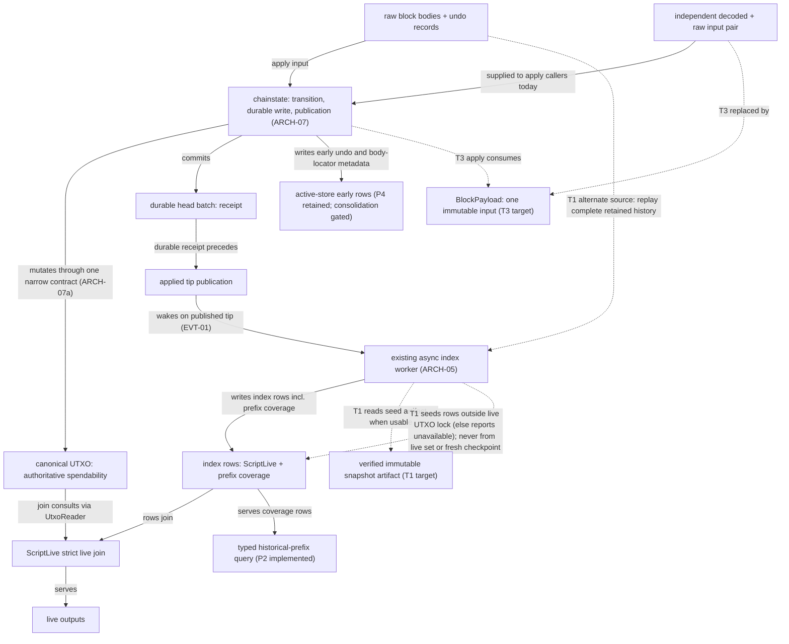

# Architecture contract

The normative contract for workspace crate layering, one-way dependency
direction, storage engine confinement, and composition boundaries.

These boundaries are internal architecture, not a compatibility promise:
they are the replaceable side of the project's external-contracts
boundary. A demonstrated better internal design may redraw them — the
`ARCH-06` change process governs layer assignments and workspace
dependency boundaries.

Owners:
- `Cargo.toml`, `crates/*/Cargo.toml`, `bin/bitcoin-rs/Cargo.toml`
- Workspace dependency gate in `bin/bitcoin-rs/tests/gates/g17_dependency_direction.rs`
- `KvStore`, `KvSnapshot`, `PrefixScanLimit`, and `PrefixScan` in
  `crates/storage/src/trait_.rs` (bounded prefix scans, `ARCH-02`)

## Layer model

| Layer | Crates | Responsibility |
| --- | --- | --- |
| 4: Compose | `node`, `bitcoin-rs`, `e2e`, `storage-footprint`, `snapshot` | Runtime assembly, lifecycle, and offline tooling |
| 3: Surface | `rpc` | External protocol boundaries |
| 2: Services | `chain`, `chainstate`, `utxo`, `p2p`, `mempool`, `index`, `mining` | Domain state and services |
| 1: Storage | `storage` | Storage contracts and engine drivers |
| 0: Core | `primitives`, `script`, `consensus` | Protocol types and validation, without storage or I/O |

Crate names use the `bitcoin-rs-` prefix except for the `bitcoin-rs` binary.

## Clauses

### `ARCH-01`: Five-layer one-way dependency direction

- Every workspace crate is assigned to an approved layer (0 to 4).
- A crate may depend only on crates in the same layer or a strictly lower layer.
  Edges pointing upward or across forbidden boundaries fail the
  `g17_dependency_direction` gate.
- The resolved workspace dependency graph is a directed acyclic graph. Any
  cycle among workspace crates, even within the same layer, fails the gate.
- The [layer model](#layer-model) assigns every crate. Additional boundaries:
  - Layer 0 crates have zero dependencies on storage, network, or filesystem I/O.
  - In Layer 2,
    `chainstate` is the authoritative applied-chain owner. It composes only
    lower/same-layer protocol, chain, UTXO, and storage capabilities; it must
    not depend on mempool, P2P, index, mining, RPC, node, or the binary.
    `utxo` sits in Layer 2 because it depends on `storage` for undo records
    and persisted coin statistics. `chain` depends on `consensus` for BIP9
    parameters and the BIP113 locktime cutoff. It does not read block bodies;
    it defines the `BlockBodySource` capability through which P2P, index,
    and RPC read persisted bodies. `mining` sits in Layer 2 because it
    depends on `mempool` for candidate selection and `chain` for candidate
    header/work/time context.
    `p2p` depends on `mempool` for the transaction inventory view and
    committed-mutation relay consumer. This same-layer edge keeps peer
    protocol mechanics with their consumer; `mempool` must not depend on
    `p2p`, `rpc`, `node`, or the binary. Admission retains peer attribution
    as data without owning connections or runtime assembly. The
    `g17_dependency_direction` gate checks this boundary explicitly.
    `p2p` also consumes chainstate-owned historical progress, window-failure
    dispositions and reorg outcomes, without enabling backend features. Node
    retains transition settlement and follower dispatch; P2P consumes these
    outcomes for scheduling, retry and peer policy through `SyncChain`.
    P2P consumes optional compact-filter queries from `index` through
    `CompactFilterQuery`; index owns generation, persistence and readiness.
    This same-layer edge does not enable storage backend features or create
    another index runtime in P2P.
  - In Layer 4, the footprint package is an offline Linux
    filesystem utility with no node/runtime-workspace or storage-engine
    dependencies. `bitcoin-rs-snapshot` is an offline Core-file inspector and
    verifier consuming the shared primitives/UTXO codec; it does not compose
    a node, P2P service, RPC server, mempool, or mining runtime.
    `bitcoin-rs-e2e` is the process-level test harness that drives
    the composed daemon and the pinned reference node over their public
    surfaces only; it declares no internal dependencies and no workspace
    crate may depend on it.
- **Explicit non-goal**: Layer numbers do not justify speculative new crates or
  thin wrapper layers. A boundary exists only when it isolates external
  dependencies, enforces safety/consensus boundaries, or separates independent
  runtime lifecycles.

### `ARCH-02`: Exclusive storage engine dependency ownership

- `bitcoin-rs-storage` is the sole crate in the workspace permitted to depend on
  underlying storage engine crates (`fjall`, `redb`, `rust-rocksdb`).
- No crate outside `bitcoin-rs-storage` may name a storage engine dependency in
  `[dependencies]`, `[build-dependencies]`, or `[dev-dependencies]`.
- All higher layers interact with persistent state through the `KvStore` facade
  and storage abstractions exported by `bitcoin-rs-storage`.
- Storage owns generic journal/checkpoint formats, filesystem operations and
  durability primitives. Its bounded `HistoryAccess` supplies optional consumers.
- Bounded prefix scans: `scan_prefix_bounded` and `scan_prefix_from_bounded` on
  `KvStore` and on `KvSnapshot` return a bounded part of one column family's
  rows under a prefix.
  - **Limit**: `PrefixScanLimit { max_rows: usize, max_bytes: usize }` bounds
    one scan. `max_rows` caps the returned rows; zero returns no rows.
    `max_bytes` caps the running total of returned key-plus-value bytes. The
    first row is exempt from the cap: it is returned even when it alone exceeds
    `max_bytes`, and its bytes count in the total. A later row is returned only
    when the total including that row stays at or below `max_bytes`. With
    `max_bytes` 10 and rows of 6 and 5 bytes, the first row is returned and the
    second is refused. A row whose byte count overflows `usize` is refused.
  - **Result**: `PrefixScan { rows: Vec<(Vec<u8>, Vec<u8>)>, complete: bool }`
    holds the rows in key order.
    `complete` is true only when the scan reached the end of the prefix with
    no row refused by the limit. An implementation MUST NOT report
    `complete = true` after it refused a row, so an incomplete result is never
    presented as complete. A limit that exactly fits the matching rows is
    complete. A zero-row limit is complete only when no row matches. A store
    that cannot serve a scan MUST return an error, never an empty or falsely
    complete scan.
  - **Seek point**: `scan_prefix_from_bounded(cf, prefix, start, limit)` takes
    an inclusive full-key `start`. Rows begin at the first key at or above the
    greater of `start` and `prefix` in byte order and end where keys stop
    beginning with `prefix`. A `start` before the prefix, including the empty
    slice, begins at the first row of the prefix. A `start` past every key of
    the prefix, including one that sorts after the prefix without beginning
    with it, yields an empty, complete scan. A caller that resumes after
    returned row `k` passes `k` followed by one zero byte, the least key above
    `k`.
  - **Required and defaulted methods**: `iter_prefix` and
    `scan_prefix_from_bounded` are required on both traits. Neither has a
    default body, so every `KvStore` and `KvSnapshot` implementation MUST
    provide both. `scan_prefix_bounded` has a default body on both traits that
    collects from `iter_prefix` under the same limit. Implementations MAY
    override it. The four redb types (`RedbStore`,
    `RedbSnapshot`, `RedbTxIndexStore`, `RedbTxIndexSnapshot`) override it and
    apply the limit inside the scan; their `iter_prefix` materializes every
    matching row. The fjall and RocksDB stores and snapshots use the default.
  - **Backends**: fjall (`range`), RocksDB (`IteratorMode::From`), and redb
    (`Table::range`) seek natively to the greater of `start` and `prefix`.
    None collects the prefix and discards its head. A scan stops at the first
    row the limit refuses, so it reads at most one row past the limit and
    drops it.
  - **Fixed-width txindex store**: `RedbTxIndexStore` and
    `RedbTxIndexSnapshot` serve `TxConfirmed`, `Funding`, `Spending`,
    `BlockHeaders`, `ScriptLive`, and `UtxoMeta`. For any other column family,
    and for a prefix wider than a fixed-width family's key, they return
    `StorageError::InvalidOperation` instead of an empty scan.
  - **Snapshot reads**: a `KvSnapshot` scan reads the view captured by
    `KvStore::snapshot`; rows committed after the snapshot are not visible to
    it. Pages read through one snapshot read one view.
  - **Bound**: a scan returns at most `max_rows` rows and at most the greater
    of `max_bytes` and the first row's key-plus-value size in bytes. A single
    oversized first row is returned whole. The limit applies to the returned
    rows. It does not bound engine-internal reads or caches, or a transient
    copy of the row it refuses: the fixed-width txindex value scan copies a
    row's value before the limit can refuse that row.
  - **Consumers**: `bitcoin-rs-index` calls `KvSnapshot::scan_prefix_bounded`
    for its txid, scripthash, spending-outpoint, and live-output lookups
    (`StoreTxIndexSnapshot::scan` and `live_rows`,
    `crates/index/src/index/snapshot.rs`). `QueryBudget::next_scan_limit`
    (`crates/index/src/runtime/query.rs`) derives each `PrefixScanLimit` from
    the query's remaining row and byte budget. `accept_scan` and
    `accept_live_scan` turn `complete = false` into
    `TxUnavailableCause::PrefixScanTruncated` or `LivePrefixScanTruncated`
    instead of returning a partial answer. The index capability reset
    (`crates/index/src/index/state.rs`) calls `KvStore::scan_prefix_bounded`
    under `RESET_SCAN_LIMIT` and deletes one page at a time. No production
    code calls `scan_prefix_from_bounded`; storage tests do.
  - Proof: `crates/storage/tests/bounded_prefix_scan.rs` tests
    `fjall_bounded_prefix_scan`, `rocksdb_bounded_prefix_scan`, and
    `redb_bounded_prefix_scan` (feature-gated; limit semantics, prefix
    boundaries, seek positions, pages resumed without gaps, snapshot isolation,
    oversized first row); `crates/storage/tests/redb_txindex.rs` tests
    `txindex_fixed_prefix_boundaries_12`, `txindex_fixed_prefix_boundaries_80`,
    `txindex_bounded_scan_empty_values`,
    `txindex_continuation_seeks_every_fixed_width_family`,
    `txindex_continuation_snapshot_is_point_in_time`, and
    `txindex_unsupported_column_families_rejected`. These tests assert returned
    rows, `complete`, and errors. The statement that a scan reads at most one
    row past the limit rests on the code: `collect_bounded_prefix` and the
    redb scan loops return at the first refused row. The `usize`-overflow
    refusal rests on `push_bounded_row` (`checked_add`); no test covers it.

### `ARCH-03`: Storage backend feature forwarding confinement

- Backend feature forwarding (`fjall`, `redb`, `rocksdb`) is strictly
  confined to:
  1. Operator-facing entry points (`bitcoin-rs-node`, `bitcoin-rs`) that expose
     backend selection to operators and packaging scripts.
  2. Services-tier adapter crates (`bitcoin-rs-chainstate`, `bitcoin-rs-utxo`,
     `bitcoin-rs-index`) whose features exist solely so `-p` package builds
     propagate backend selection into `bitcoin-rs-storage`.
  3. `bitcoin-rs-storage` itself, which owns the concrete backend engine
     dependencies and exposes them through the `KvStore` facade.
- Crates in Layer 0 (Core) and Layer 3 (Surface / RPC) must never define or
  forward storage backend features.
- `bitcoin-rs-chain`, `bitcoin-rs-p2p`, `bitcoin-rs-mempool`, and
  `bitcoin-rs-mining` do not own storage and must not define or forward
  backend feature names; an empty `rocksdb = []` marker counts as defining a
  backend feature and is forbidden.
- `bitcoin-rs-node` and `bitcoin-rs` may forward backend selection only into
  engine-selecting crates (`bitcoin-rs-storage`, `bitcoin-rs-chainstate`,
  `bitcoin-rs-utxo`, `bitcoin-rs-index`).
- `fjall` is the default shipped product backend. `redb` and `rocksdb` are
  retained shipped alternatives and independent product-matrix comparisons.
  MDBX had only a diagnostic role and no current consumer; it is removed as a
  complete ownership unit. Existing MDBX datadirs are not migrated or opened.
- `crates/node/src/storage_backend.rs` is the sole owner of concrete runtime
  backend construction in the node. Chainstate and txindex each cross that
  boundary once, then immediately compose backend-neutral capabilities for
  undo, pruning, journal, indexing, and footprint inspection. The consumer
  visitor is only a composition seam; `KvStore` remains the owner of reads,
  writes, batches, and durability. The txindex redb lane retains its specialized
  fixed-width store rather than being widened to the generic redb adapter.

### `ARCH-04`: RPC surface independence from storage

- `bitcoin-rs-rpc` must have zero non-test dependency edges on
  `bitcoin-rs-storage` and zero dependencies on storage engine crates.
- RPC consumes node capabilities (chain, mempool, index, network, mining, utxo)
  exclusively through the capability groups `Context` stores (`ChainHandles`,
  `MempoolHandles`, `IndexHandles`, `NetworkHandles`, `MiningHandles`), never
  through direct database access. `Context::from_handles(ContextHandles)` is
  the single composition point: one `ContextHandles` value carries every
  capability, including the transition-exclusion read role, and production
  wiring attaches nothing to a built `Context`.
- `bitcoin-rs-rpc` defines and forwards zero backend features. (The bench-only
  dev-dependency used for offline `txoutproof` fixtures is isolated to test
  scope and documented in `crates/rpc/Cargo.toml`).

### `ARCH-05`: Node composition and orchestration boundary

- `bitcoin-rs-node` (Layer 4) is the assembly and lifecycle orchestration layer.
  It wires together storage backends, consensus validators, mempool gateway, P2P
  listeners, index reconciliation workers, and RPC services into an executable
  node runtime.
- Domain mechanics belong to domain crates: consensus rules in consensus/script,
  mempool admission and mutation sequencing in mempool, connection lifecycle in
  p2p, template assembly and the mining control contract in mining, and index
  schemas in their owning crates. `bitcoin-rs-mining` owns `Candidate`,
  `BlockTemplate`, `MiningInfo`, and `MiningControl`, plus the candidate
  lifecycle: the `(applied_tip_hash, mempool_sequence)` generation key, the
  bounded template cache with single-flight assembly, long-poll publication,
  and BIP22/BIP23 template projection (`MiningService`, fed by node-owned
  capability sources). Mining also owns `MiningGenerationSignal` (the
  authoritative-mutation wake seam, `generation_signal`), `getnetworkhashps`
  estimation (`network_hashps`), and the BIP22/`submitheader` reject
  vocabulary (`bip22`). RPC maps those types onto BIP22/BIP23 JSON and does
  not cache templates or long-poll.
- `bitcoin-rs-mempool` owns transaction admission preparation and retry,
  orphan bodies and their indexes, ready-orphan work, and recent rejects
  through the shared `MempoolGateway`. It also owns the fee-estimator history
  file format and its atomic datadir persistence (`fee_history`,
  `fee-estimator-history.dat`); node only calls `load` at open and `save` at
  shutdown. `bitcoin-rs-p2p` owns the transaction
  inventory implementation, missing-parent requests, source-connection checks,
  and the bounded transaction relay queue, worker, and saturation policy.
  Node supplies the chain view, connects committed admission results to relay
  and mining, and owns channel wiring and worker startup/shutdown. It keeps no
  second admission-state store or transaction policy implementation. Admission
  sequencing follows [MPL-04](mempool-mutations.md); wire behavior and its
  deviations follow [P2P-01](p2p-wire.md).
- `bitcoin-rs-node` owns runtime startup/shutdown sequencing, configuration
  resolution and validation (`UserConfig` layers → `NodeConfig`), the mining
  control facade (`MiningCoordinator`: it composes the mining lifecycle
  service with Chainstate's read and transition capabilities, submits solved
  blocks, and requests header admission from Chainstate),
  watch-only coinbase payout configuration (`MiningConfig::payout_script`), and
  process-level cache budgeting (`dbcache` distribution across chainstate and
  txindex namespaces). The node option table (`crates/node/src/options.rs`)
  declares every operator option once, with its value grammar and its spelling
  on each process-input surface; the `bitcoin-rs` binary expands that table into
  its argv, environment, TOML, and `bitcoin.conf` readers. Applied-tip mutation,
  recovery, checkpoint publication,
  mandatory retention consumption, and branch switching are owned by
  `bitcoin-rs-chainstate`
  (`ARCH-07`), not by a public field bag of subsystem handles. The
  retained-history authority itself — the registry, the executed frontier, and
  prune reserve/commit — is owned by `bitcoin-rs-storage::pruning`; node
  composes that one authority into chainstate, the prune service, and bounded
  index history.
- `bitcoin-rs-rpc::zmq` owns ZMQ topics, framing, HWM validation, socket
  transport, mempool sequence projection, and live notifier enumeration.
  `bitcoin-rs-node` constructs and wires the publisher and continues to own when
  committed chain effects are emitted. The same live publisher is the source for
  `getzmqnotifications`; node does not keep a parallel notifier metadata model.
  The `g17_dependency_direction` gate pins the external `zmq` dependency to the
  surface crate and permits node only to forward `bitcoin-rs-rpc/zmq`.
- `ARCH-07` owns transition reservation and post-commit follower dispatch.
- The option table is the one declaration of an operator option. A row names
  its configuration slot, its text grammar, and its spelling on the command
  line, in the environment, in the TOML file, and in `bitcoin.conf`. The
  `bitcoin-rs` binary holds no option name or grammar of its own beyond the two
  configuration-file selectors and the storage-measurement flags.
- `resolve` folds every layer through `UserConfig::overlay` in precedence order,
  lowest first: a set field replaces the earlier value, an unset field leaves
  it, and nested override structs merge the same way, including
  `ChainstateJournalOverrides` and `MiningOverrides`. `overlay` also applies the
  RPC credential style rule within the layer being folded, so a later password
  clears an inherited cookie path and a later cookie path clears inherited
  user and password. After the fold, the winning `network` value fills the
  profile-owned fields once through `NetworkProfile::for_selection`, and
  `rpc_auth` chooses the final credential style from the winning values.
  Proofs: `crates/node/tests/unit/config/tests.rs`
  `resolve_prefers_higher_layers_field_by_field`,
  `rpc_cookie_and_credential_layers_keep_one_auth_source`, and
  `earlier_set_fields_survive_a_later_bare_network_selection`.

### `ARCH-06`: Hierarchy change and exception process

- Any change to workspace crate layer assignments, introduction of new workspace
  crates, or addition of cross-crate dependencies requires:
  1. Updating the `approved_layer` table or engine crate assertions in
     `bin/bitcoin-rs/tests/gates/g17_dependency_direction.rs`.
  2. Updating this normative contract (`docs/contracts/architecture.md`) with
     the rationale and invariant justification.
  3. Passing the `g17_dependency_direction` gate test.
- Speculative or circular dependency edges that violate the one-way flow are
  rejected by automated gate enforcement in CI.

### `ARCH-07`: Chainstate owns authoritative applied-chain mutation

- `bitcoin_rs_chainstate::Chainstate` is the in-process owner of applied-tip
  mutation, recovery, branch switching, checkpoint payload assembly/publication,
  and mandatory retention consumption. `NodeState`, `BlockSync`, mining, and RPC
  chain-control hold or clone that service; they do not assemble a transition
  from independent locks.
  Retained-history *authority* is not chainstate's:
  `bitcoin-rs-storage::pruning` owns the `RetentionRegistry`, the executed
  frontier, and prune reserve/commit, and node composition seeds that one
  registry and distributes it. Chainstate receives
  [`bitcoin_rs_storage::MandatoryRetention`] for transition pins and the
  existing bounded `HistoryAccess` role for optional block-input queries.
  Both originate from that same registry; neither can prune, commit, or shut
  down retention, and chainstate is not a broker for the registry.
- `BlockUndoSource` is implemented directly by `Chainstate`; RPC holds only
  that read trait. A query captures the caller's applied hash, full durable
  receipt, and storage-owned history lease under the transition domain.
  Bounded body/undo reads and projection run outside tree/write/transition
  locks, followed by exact receipt, applied-hash, and lease revalidation.
  Historical snapshot prefixes need durably archived validation progress;
  retained bytes alone never establish validation. The current undo extent
  can certify a disconnected branch until a later receipt replaces it.
- `Chainstate::begin_transition` and `TransitionLock::into_transition` are the
  only constructors of a `ChainTransition`. Reorg planning that must abort
  without mutating takes `lock_transition` first and promotes the lock with
  `into_transition` only after the authoritative plan matches the preloaded
  plan.
- Snapshot reads (`Chainstate::snapshot`) copy the independently published
  header tip and a coherent applied-tip / chain-tx-count pair. They do not
  take the transition lock and cannot mutate chainstate. `ChainEventPublisher`
  cells remain a separate coherent snapshot of the applied tip for index
  consumers (`EVT-01`).
- Long-lived RPC, P2P, index, and mining consumers receive `TipReader`,
  `BlockTreeReader`, and `StableRead` capabilities. The readers expose
  snapshot load and tree read guards respectively; every `&self` tree
  accessor is a pure read, and the tip publication cell is only shareable
  through `&mut BlockTree`. `StableRead` excludes authoritative transitions
  for as long as a read that needs one coherent chainstate runs; its only
  production verbs are `lock` and bounded `try_lock_for` (zero timeout for an
  immediate attempt), it hands back an opaque guard, and it has
  no way to reveal its matching `TransitionAuthority` — the role chainstate
  and destructive pruning hold across a mutation. `NodeState::open` mints one
  `TransitionDomain` for that node and distributes matching roles to its
  production consumers. `Chainstate` does not republish a fence:
  `Chainstate::read_fence` does not exist and the g17 facade gate denies it.
  This is a production wiring guarantee, not a type-level provenance guarantee:
  `TransitionDomain::new`, `Default`, and `stable_read` are public, and
  `ChainHandles::default` in the public `Context::new` fixture mints a private
  domain. Passing such a role to a live node reader does not exclude that
  node's transitions. Header admission uses
  `Chainstate::admit_headers`; normal genesis connect publishes through the
  tree's shared tip cell without a separate publication fallback.
  Short-lived `ChainAdmissionView` values borrow readers; the P2P transaction
  ingress worker acquires its owned readers once at startup.
- `Chainstate::validate_block` dry-runs the apply path's pre-write consensus
  gates under `lock_transition`. It does not take mempool generation and does
  not persist. BIP22 proposal omits proof-of-work; every other pre-write gate
  is the same function commit runs. Owner: `crates/chainstate/src/lib.rs`.
- Authoritative apply lives in `crates/chainstate`. The crate does not hold
  or import mempool, RPC, ZMQ, index, mining, P2P, or node types. Apply publishes the tip and
  returns a `ConnectOutcome` or `DisconnectOutcome`. Capture flags
  are set at construction so apply can produce
  `rawtx` and canonical block bytes without holding the consumers.
- Node owns cross-domain sequencing around a chain transition: it reserves the
  mempool generation, dispatches `ChainFollowers`, then publishes the stable
  mempool generation before the chain transition is dropped. Follower-free
  convenience methods are compiled only for tests or the `test-seam` capability.
  In-workspace production dependencies and feature forwarding must not enable
  that capability; production composition uses explicit transitions plus
  follower settlement. Downstream users can explicitly opt into `test-seam`.
  RPC `BlockLog`, hash/raw ZMQ, TxIndex wake, sequence `C`/`D`, mining
  generation, admission, block-confirmation eviction, and reorg
  reconsideration run from node-owned dispatch. Consumer failure cannot
  invalidate chainstate. Issue #77
  owns the durable event journal; this is dependency direction, not a second
  event contract. Do not push cross-store ordering into `utxo` or `storage`.
- Reorg planning, body retention/loading, disconnect/connect execution,
  invalidation, and checkpoint-debt settlement live in chainstate. Node supplies
  a `ReorgObserver` for mempool/follower effects and holds the mempool
  generation fence around the operation. Reorg body memory is bounded by the
  chainstate streaming window; no whole departed branch is retained.
- Runtime capability ownership remains with the subsystem that mutates it.
  `P2pService` owns peer sessions, bans, the network-active latch, and its
  header/block/outbound channels; `ChainFollowers` owns the RPC block log,
  ZMQ publisher, and mining-generation signal; `Chainstate` owns the IBD
  latch. `NodeState` composes those services and returns their handles without
  retaining parallel fields. Its inbound transaction channel is node-owned
  because node orchestration drains it into `MempoolGateway`. Confirmed
  transaction bodies are queried through the derived index and durable block
  storage, never through a second node/RPC transaction map. RPC network
  answers and control operations likewise read and mutate network state through
  `P2pService` directly (querying the P2P-owned peer table, traffic counters,
  ban list, added-node list, and network-active latch, and invoking service
  control methods for bans, added nodes, network-active toggling, and
  disconnections). RPC no longer receives raw handles for bans, added nodes,
  the network-active latch, or the outbound dial channel; the peer table stays
  as a read view, and there is no parallel RPC-local network-state projection
  or duplicate mutation authority.
- `MempoolGateway` owns the process mempool handle; `NodeState::mempool` is a
  read/composition capability borrowed from that gateway, not a parallel
  retained `Arc`. Gateway interning remains the public one-gateway-per-pool
  enforcement boundary for test seams and downstream composition; production
  constructs that same owner once. `NodeState` retains `PruneService` as a
  node/storage mutation capability because it is created only after
  chainstate supplies prune authority and is handed to the later RPC
  lifecycle; it contains no duplicate block or transaction projection.

### `ARCH-07a`: Chainstate mutates `utxo` through one narrow contract

`bitcoin-rs-utxo` is not a second mutation authority: it holds the live coin
set and the persistence formats, and chainstate drives it through one
coherent apply/commit/disconnect contract (`crates/utxo/src/contract.rs`).

- **Apply**: `build_block_changes` turns one validated block into its
  `BlockChanges`, its `UndoBatch`, and the `BlockValueTotals` the coinbase
  check needs. Resolved prevouts enter through `SpentOutputLookup`; the live
  set at BIP30 exception heights enters as the optional overwritten lookup.
- **Commit**: `contract::commit_block_changes` applies one block's
  `BlockChanges` and
  emits commit events to the single attached `CoinStatsListener`; the set's
  raw mutator is crate-private.
- **Disconnect**: `persist_block_undo` / `load_block_undo` round-trip one
  block's `UndoBatch` as the `UndoRecord` bytes the durable head receipt
  names, and `rollback_block` applies that batch under the durable
  disconnect marker plus the coinstats rewind. The raw inverse
  (`UtxoSet::undo_block`) is crate-private: every external disconnect goes
  through `rollback_block`.
- **Read**: `UtxoSet::get` returns the `TxOut` payload while `get_entry`
  returns the one `UtxoCoin` shape; whole-set
  reads run under `with_stable_view` (`UtxoSetView`), which also serves the
  `hash_serialized_3` commitment, script scans, and memory accounting.
  Windowed apply reads through `WindowOverlay` over the same `OutputSource`.
- **Distribution**: production consumers receive `UtxoReader`, never the
  set. It answers `get`, `get_entry`, `has_live_outputs_for_txid`,
  `scan_script_pubkeys`, and the two stable whole-set reads, and carries no
  route to `utxo::contract`. `Chainstate::utxo` and
  `Chainstate::utxo_handle` are fixture-only seams, and
  `UtxoReader::fixture_set` — the one route back to the set — is compiled
  out of production builds, so the g17 facade gate can deny all three from
  an isolated production consumer.
- Shard, record, commit-event, and undo-codec machinery is crate-private.
  Rollback sequencing is split at the marker fence, which is exactly where
  the crate boundary runs: `utxo::contract::rollback_block` owns the fenced
  set mutation (arm the marker, undo the set, rewind coinstats, complete the
  marker) and nothing beyond it. Chainstate owns everything around that
  fence — refusing a stale tip before arming, then journal rewind, durable
  head advance, and publication. It disarms the marker only when the journal
  rewind succeeds; otherwise a matching clean checkpoint disarms it after
  publishing the rolled-back set. Chainstate owns this surrounding order and
  durability policy (`ARCH-07`).
- The contract surface is `bitcoin_rs_utxo::contract`; the crate root keeps
  only read, snapshot, and statistics names. RPC and P2P admission read
  through `UtxoReader` (`UtxoCoin`, `UtxoScan`); index is the read consumer
  that decodes the contract's `UndoBatch`. None assembles mutations outside
  tests, which build fixture sets through
  `BlockChanges` + `commit_block_changes` on `fixture_set()`.

### `ARCH-07b`: AssumeUTXO chainstate roles and single active authority

- **Chainstate roles**:
  `bitcoin_rs_chainstate::ChainstateRole` explicitly defines the lifecycle state
  of every instantiated chainstate:
  1. `Ordinary`: standard fully validated chainstate.
  2. `AssumedActive`: snapshot-loaded chainstate actively driving the node tip,
     retaining its snapshot base height and block hash.
  3. `Historical`: background chainstate validating from genesis or an accepted
     historical checkpoint up to the snapshot base height.
- **Single active authority invariant**:
  At all times, exactly one chainstate acts as the authoritative active chainstate
  (`Ordinary` or `AssumedActive`). Only the active chainstate drives mempool admission,
  mining block template assembly, RPC/ZMQ chain effects, indexer updates, and pruning
  execution. The historical chainstate runs background validation using the consensus
  connect path (`Chainstate::connect`), but its events are detached and never routed to
  mempool, mining, RPC, ZMQ, or indexers.
- **Snapshot activation and pinned metadata**:
  Activation of an AssumeUTXO snapshot is coordinated exclusively by `AssumeUtxoManager`.
  Snapshot height and block hash must match pinned network metadata (`AssumeUtxoData`).
  The manager consumes the imported set and computes its `hash_serialized_3` commitment;
  caller-supplied digests and snapshot trailers do not establish trust. This is Core's
  `HASH_SERIALIZED` commitment, not MuHash. The pinned transaction count seeds the
  active tip; it is independently checked during historical finalization. The base
  header must already exist at the pinned height, be valid, and be an ancestor
  of the current best-work header tip. The installer rechecks these facts under
  transition exclusion before the lifecycle commit. The snapshot base must carry
  strictly more cumulative work than the settled active tip; height alone does
  not order competing branches. Coin statistics are rebuilt from
  the imported coins, and the resolved header supplies chainwork. Installation and
  role changes serialize with chain transitions; failed validation publishes nothing.
- **Compiled mainnet anchors and provenance**:
  `Network::Mainnet.assume_utxo_data()` supports heights 840,000, 880,000, 910,000,
  935,000, and 965,000, retaining the earlier anchors. The first four entries match
  [Bitcoin Core v31.1 chain parameters at `9be056a8a72b624dae9623b2f7bded92c2a21c91`](https://github.com/bitcoin/bitcoin/blob/9be056a8a72b624dae9623b2f7bded92c2a21c91/src/kernel/chainparams.cpp);
  the 965,000 entry comes from
  [Bitcoin Core v32.0rc1 at `d0231bb01d83178224bf7b198ba04f78cc2c89ef`](https://github.com/bitcoin/bitcoin/blob/d0231bb01d83178224bf7b198ba04f78cc2c89ef/src/kernel/chainparams.cpp).
  The block hashes, `hash_serialized_3` commitments, and cumulative transaction
  counts are owned by `crates/primitives/src/network.rs`. These anchor additions
  leave the project's broader Bitcoin Core compatibility baseline unchanged.
- **Snapshot format and interoperability evidence**:
  The embedding file activation API reads native bitcoin-rs v4 snapshots.
  `loadtxoutset` uses the shared Core portable v2 reader and existing activation
  owner; `getchainstates` projects that owner's lifecycle (`API-33`). Process
  coverage uses a genuine Core-produced regtest-200 artifact. Compiled mainnet
  anchors alone do not establish hosted artifact availability, mainnet
  interoperability, or memory/throughput qualifications.
- **Background validation and convergence**:
  The historical chainstate validates blocks up to the snapshot base height. It refuses
  to connect blocks past the base height or blocks that diverge from the expected target
  hash (`ApplyError::ConnectPastHistoricalTarget` and
  `ApplyError::HistoricalTargetHashMismatch`, respectively). When validation reaches
  the base height, the reconstructed `hash_serialized_3` and cumulative transaction
  count must match the pinned metadata:
  - If valid, the active chainstate transitions from `AssumedActive` to `Ordinary`, the
    historical chainstate is retired, and disk status is marked `Finalized`.
  - If invalid, the manager persists `AssumeUtxoDiskStatus::Failed`, marks the active
    chainstate permanently closed for recovery (`Chainstate::fail_closed_for_recovery`), and
    refuses subsequent restarts to protect operator data.
  Historical replay uses its own isolated coins, transient durable-head and undo stores,
  no body writer, and detached events. The manager archives validated body locators
  and undo records together with lifecycle progress in the active durable-head batch.
  These batches advance `commit_id` while preserving the active tip and transaction
  count. They publish no active-chain notification. Transient undo is released after
  the archive receipt, so it does not accumulate through the entire history.
  Historical progress checkpoints reuse the chainstate checkpoint format in a
  separate namespace. The durable head records the accepted generation, height,
  and hash; startup restores that checkpoint and replays only its certified
  archive suffix. Without an accepted checkpoint, startup safely falls back to
  genesis replay. The summary exposes live progress separately.
  Historical publication retains earlier generations until the head accepts
  the replacement; recovery selects the head's generation independently of
  `CURRENT`. Snapshot activation refuses an unresolved full-revalidation marker.
  Replaying a block already covered by an archive receipt does not rewrite its
  body or progress. Before checking a new body, the manager syncs its staged bytes and commits a
  pending-validation reference in the same root. If a crash or terminal-status
  write failure leaves that reference, startup reconstructs the dependencies and
  completes the check before returning node state. A mismatch cannot be forgotten
  by restarting after a failed `Failed` write. Finalization is durable before the
  role becomes `Ordinary`; unresolved storage errors close both admissions.
  Production sync pipelines bodies on the pinned base ancestry through a separate
  instance of the existing download window and block stager: at most 32 pending
  and staged bodies in total, 16 in flight per peer, and 64 MiB of staged wire
  payload (plus the stager's one-front-body allowance to avoid a full-tail deadlock).
  Decoded bodies also occupy bounded memory alongside their wire payloads.
  Smaller configured budgets still apply. Archive-capable peers supply batches;
  connection leases, timeouts, retry and backpressure use the shared download policy.
  Body binding is checked before staging. Each historical pass makes at most nine
  chain-owner calls, each replaying at most eight retained blocks, and admits at most
  eight staged bodies in pinned ancestry order, refilling the window while later
  bodies remain staged. A sync tick runs a pass before and
  after draining deliveries. Replay retires overtaken downloads; completion clears
  transient staging. Only validation publishes body locators and lifecycle progress.
  Foreground and historical deliveries have separate owners. Mainnet throughput and
  absolute restart-latency guarantees remain unproven follow-ups to #1288; the
  restart contract is bounded by the historical checkpoint interval once an
  accepted checkpoint exists.
- **Reorg and pruning constraints**:
  - Reorgs on the `AssumedActive` chainstate cannot disconnect blocks at or below the
    snapshot base height (`ApplyError::DisconnectBelowSnapshotBase`).
  - `PruneAuthority::begin` refuses prefix pruning while either chainstate has a
    snapshot role. Even a requested height above the base would delete required
    history. The role check shares the chain-transition lock with activation and
    finalization, so pruning cannot race a role change.
- **Operator observability**:
  `AssumeUtxoManager::chainstates_summary` provides a unified read projection of both
  active and background chainstates, reporting roles, tips, validation progress, and
  commitments without exposing internal lock primitives.
- **Durable activation and recovery**:
  Immutable coin and header archives are synced before the active head commits the
  pinned base and lifecycle status. That head is the only activation authority;
  orphan import files do not activate a snapshot. Each exclusively created
  temporary reservation is file-locked before writing and stays locked through
  rename and directory sync. Before publishing a recovered manager, cleanup
  probes that lock and reclaims only exact generated reservation names in
  compiled base directories. Coin reservations must contain native-v4 metadata
  matching the pinned base; header reservations are recognized only by the
  network's genesis-header prefix, not by validating a complete header archive.
  Files are opened without following symlinks, using `O_NONBLOCK` on Unix.
  The opened descriptor must identify a regular file before locking or reading.
  Live writers, special files, unknown names/formats, unidentifiable fragments,
  symlinks and final archives are preserved. Cleanup failure retains extra files for retry;
  it cannot reset the accepted head or truncate an operator artifact. Startup
  admits the current schema,
  validates the root's network pin, and restores a compatible checkpoint or verifies
  the snapshot archive, then replays the certified foreground suffix to the head.
  A checkpoint remains an accelerator, including after finalized history is pruned.
  Activation detaches the old checkpoint journal; anchored recovery does not replay
  that journal across the snapshot jump. Node-owned mempool reconciliation follows
  [MPL-04](mempool-mutations.md#mpl-04-generation-validated-admission-and-chain-change-fencing).
  Activation wakes index/mining consumers without emitting per-block ZMQ events
  for imported history. Historical undo makes below-base reorgs
  possible after finalization; crossing below the base removes the snapshot anchor
  in the disconnect's authoritative batch.

### `ARCH-08`: Durable pruning and reorg retention

- Transaction-cache pruning must not remove transactions from a block above
  the durable checkpoint's reorg-retention floor. A requested prune height
  becomes eligible only after durability has been published through
  `CORE_REORG_SAFETY_MARGIN`; this protects reconsideration of disconnected
  transactions during reorg handling.

### `ARCH-09`: Authoritative owners and read-only capability boundaries

- Active-tip waits use `chain::ActiveTipWait`, implemented directly by
  `Chainstate` and composed in RPC's `ChainHandles`. The existing applied-tip
  ArcSwap remains the sole published tip; one owner-local mutex/condition
  variable coordinates publication and cancellation. Waiters release that
  gate before acquiring transition exclusion. Each RPC dispatcher owns its request
  budget and service cancellation latch, not another chain tip or event history.

- Subsystems keep exactly one authoritative mutation owner for each piece of
  state. External consumers and cross-subsystem adapters receive read-only
  capabilities or single-consumer ownership rather than cloneable mutable handles:
  - **`BlockLog`**: Exclusively owned and mutated by `ChainFollowers`. Consumers
    (RPC handlers, derived index runtime, node queries) access block records
    through the read-only capability `BlockLogReader`. Mutation methods
    (`BlockLogReader::write`) and raw mutable handles (`BlockLogReader::raw_handle`)
    are gated behind the explicit `test-seam` feature.
  - **P2P Inbound Channels**: Single-consumer ownership is enforced for ingress
    channels. Channel receivers (`inbound_headers_rx`, `inbound_blocks_rx`,
    `inbound_tx_rx`) are moved by value to their respective worker loops
    (`BlockSync`, `spawn_tx_ingress_consumer`) using single-take accessors
    (`take_inbound_headers_receiver`, `take_inbound_blocks_receiver`,
    `take_inbound_tx_receiver`). Exposing cloneable `Arc<Mutex<Receiver<...>>>`
    handles in production runtime wiring is prohibited.
  - **`Chainstate`**: Owns the block tree, applied/header tip cells, and process
    shutdown signal. Construction via `ChainstateParts` consumes `BlockTree` by
    value and `restored_applied_tip: Option<TipSnapshot>`, eliminating
    construction-time mutable handle leaks. Mutation authority remains strictly
    confined to chainstate methods; external consumers observe tip state via
    `TipReader` and `BlockTreeReader`.
  - **Shutdown and Ban Capabilities**: Cancellation and ban state are exposed
    through read-only capabilities (`LatchReader`, `BannedReader`). Ordinary
    workers and subsystems query ban status and observe shutdown through these
    capabilities without holding mutable handles or raw atomic pointers.
    Shutdown mutation authority remains strictly encapsulated behind
    `request_shutdown()` and dedicated lifecycle handlers.
- Intentional `Arc` / `Weak` shared ownership invariants:
  - `Arc<PeerTable>`: Shared among P2P service, connection listeners, sync, and
    RPC network handles. `PeerTable` is internally synchronized and owns peer
    leases and address tracking.
  - `Weak<MempoolGateway>`: Held by the P2P transaction relay observer
    (`LocalTxRelayObserver`) to prevent cyclic reference cycles and ensure that
    observer registration does not artificially prolong gateway lifetime.
  - `UtxoReader`: Read-only projection of the authoritative `UtxoSet` (which is
    mutated solely by chainstate under transition locks) to mempool and RPC.
  - `InitialBlockDownload`: Supplies the shared IBD decision across sync and
    header presync by observing chain progress through read-only capabilities
    (`TipReader`, `BlockTreeReader`), while worker orchestration belongs to
    `BlockSync`.

## Current boundary and target design

This section states what runs and what remains target. In the graph,
solid arrows are implemented and dotted arrows are targets. Ownership
for the implemented behaviors lives in `ARCH-07` / `ARCH-07a`,
`ARCH-05`, `ARCH-02`, `IDX-12` in [indexing](indexing.md) with the
historical-prefix reads in [embedding](embedding.md), and the retained
rows below; ownership for the targets lives in the `T1` / `T3` clauses
below.

### T1: snapshot-seeded ScriptLive outside the live UTXO lock (target)

The seeder MUST run under the existing worker, retention, and
reconciliation owners named in `ARCH-05` and `ARCH-07` / `ARCH-07b`,
and MUST NOT hold the live UTXO lock while seeding. The seed source
MUST be a verified immutable artifact when one is usable; otherwise the
existing worker MUST replay complete retained history when that complete
source is available under existing retention limits; when neither source
suffices, the seed MUST report unavailability explicitly. The
seed MUST NOT fall back to the live UTXO set and MUST NOT create a
fresh checkpoint on demand. Ownership stays where it is today:
activation roles and retention authority in `ARCH-07` / `ARCH-07b`,
ScriptLive as a fixed-width family under `ARCH-02`. Comparison
(reference only): Core keeps live reads on the coin cache independent
of any index prefix
([coins.cpp](https://github.com/bitcoin/bitcoin/blob/9be056a8a72b624dae9623b2f7bded92c2a21c91/src/coins.cpp#L68-L80));
no snapshot-seeded index path was found in the inspected Core code.

### P2: typed historical-prefix query with scoped absence (implemented)

Consistency and embedding usage are owned by `IDX-12` in
[indexing](indexing.md) and the historical-prefix reads in
[embedding](embedding.md); this clause states only the architecture
boundary. Each call takes one immutable snapshot, derives the bounded
common covered ancestor of its required capability watermarks and the
published tip, reads only heights from the maximum required floor
through that anchor on that chain, then rechecks the anchor against the
active tip after the read. Each call takes its own DB snapshot and
chooses its prefix independently; callers MUST NOT assume equal anchors
across calls, even when coincident calls return the same prefix. Absence is scoped to that
prefix, never a global negative. Full script history on a positive
floor stays unproven because funding below the floor can hide in-range
spends; the exact-outpoint spend lookup and the transaction lookup MAY
report scoped absence after verifying the in-range rows. Strict
ScriptLive reads and Core-compatible endpoints keep their current
semantics: bounded scans under `ARCH-02` and `BlockUndoSource` reads
with receipt, applied-hash, and lease revalidation under `ARCH-07`. The
ancestry guard is a btcrs rule derived from the captured prefix. The
pinned Core persistence guard is reference only: an index skips its
persist unless its tip is an ancestor of the last flushed block
([base.cpp](https://github.com/bitcoin/bitcoin/blob/a773e1e33b349dc819b5a0edc1c7a4839dc73b48/src/index/base.cpp#L277-L305));
it describes no Core per-query behavior. An old-branch persisted cursor
stays possible: strict reads refuse the stale watermark, while
historical reads may serve the proved common prefix while the worker
rewinds asynchronously.

### T3: one private immutable BlockPayload in place of independent pairs (target)

Callers that today take an independent decoded input and a raw input
MUST instead take one immutable `BlockPayload` bound to the exact wire
serialization. The fields are private. Ownership stays where it is
today: the apply path in `ARCH-07` / `ARCH-07a` is where the paired
call shape lives; the payload narrows that call shape and adds no new
crate, layer, runtime, or parser.

### P4: retain current early rows until staged readers and recovery proof permit consolidation (implemented retention; consolidation gated)

The current early undo and body-locator rows MUST stay until every
staged serving reader, historical undo consumer, and recovery dependency
has a replacement and the audit gate passes. Body bytes are appended
once; only metadata is repeated. The UTXO cache stays deferred until a
supported memory requirement is demonstrated. Explicit non-goals are no
wholesale archive replacement, no second runtime, and no generic MVCC
or copy-on-write. Comparison (reference only): the relational archive
rebuilds historical wire bytes from a join instead of keeping raw
blocks
([architecture](https://github.com/reardencode/rbitcoin/blob/572e72c1ce0b1c16dcd7182872a1e9c0089afd6a/docs/architecture.md),
[reconstruct](https://github.com/reardencode/rbitcoin/blob/572e72c1ce0b1c16dcd7182872a1e9c0089afd6a/crates/rbitcoin-query/src/reconstruct.rs));
the raw-body choice kept here is the opposite.

## Test and evidence isolation

Default production builds contain no storage persistence fault slots,
checkpoint/journal injection branches, synthetic `Chainstate::new`, or RPC
synthetic-world constructors/defaults. Explicit `test-seam` features expose
fixtures; only dev-dependencies opt in in the production workspace graph.
This is build isolation, not a security boundary against downstream feature
selection. Production RPC composition remains `Context::from_handles` and
chainstate composition remains `Chainstate::from_parts`.

Offline allocation measurement and its dependencies live in
`tools/storage-footprint`, never in node startup/storage behavior.

## Remaining composition boundary

Ownership is defined in [ARCH-02](#arch-02-exclusive-storage-engine-dependency-ownership)
and [ARCH-03](#arch-03-storage-backend-feature-forwarding-confinement) (storage and
backend construction), [ARCH-05](#arch-05-node-composition-and-orchestration-boundary)
(node assembly) and [ARCH-07](#arch-07-chainstate-owns-authoritative-applied-chain-mutation)
(chainstate transitions and the separate storage retention authority).

## Proven by

- `bin/bitcoin-rs/tests/gates/g17_dependency_direction.rs`:
  - `workspace_dependency_direction_is_one_way`: validates `cargo metadata --no-deps`
    against the manifest-level portions of `ARCH-01`–`ARCH-04` and the production
    feature isolation rule above.
  - `fixture_owners_expose_no_production_injection_or_synthetic_constructors`:
    compiles an isolated consumer; ordinary read/composition APIs must compile,
    while persistence/checkpoint injection, the old footprint module, and
    synthetic chainstate/RPC constructors must be absent.
  - `chainstate_facade_exposes_no_production_raw_mutation_handles`: compiles an
    isolated Cargo consumer without dev-feature unification. Read operations
    and `BlockUndoSource` reads must compile; raw mutation handles, undo writes,
    retention acquisition, reader write/publication methods,
    mutable tip-cell access through a read guard, and `SyncChain` fixture
    methods must fail with the intended compiler diagnostics. Removing an
    obsolete accessor or private field remains allowed, and the deleted
    `Chainstate::retention_handle`, `Chainstate::read_fence`,
    `Chainstate::utxo`, and `Chainstate::utxo_handle` accessors stay deleted:
    retained-history authority, the transition domain, and the authoritative
    UTXO set are owned elsewhere and chainstate must not broker any of them.
    The deleted `Chainstate::read_block_tree` stays deleted too: tree reads,
    including the P2P `SyncChain` adapter's, go through `BlockTreeReader`.
    The same consumer asserts `UtxoReader::fixture_set` is unavailable, so a
    production reader cannot reach the set `utxo::contract` mutates.
- `crates/storage/tests/bounded_prefix_scan.rs` and
  `crates/storage/tests/redb_txindex.rs`: bounded prefix scan limits, seek
  points, completeness, and snapshot isolation (`ARCH-02`).
- `crates/chainstate/tests/unit/apply/admission_tests.rs` and
  `crates/chainstate/tests/unit/apply/chain_tx_count_tests.rs` cover admission
  shutdown and coherent chain transaction-count publication. Checkpoint and
  journal tests moved with their owner under `crates/chainstate/tests/unit/`.
- `crates/node/src/chain_effects.rs` and node mining/sync/reorg integration
  tests prove that mempool/follower work consumes committed chainstate outcomes
  without making chainstate depend on those consumers.
- `crates/node/tests/unit/state/tests/construction.rs` test
  `runtime_accessors_borrow_their_subsystem_owner` and
  `crates/node/tests/unit/lifecycle/tests.rs` test
  `rpc_network_handles_borrow_p2p_service_state` prove that node and RPC
  composition reuse the owning service's handles rather than retaining
  parallel runtime projections.
- `crates/node/src/chain_effects.rs` tests `noop_asks_for_no_payloads`,
  `connect_then_disconnect_rewinds_the_rpc_log_and_emits_in_order`,
  `disconnect_does_not_pop_a_different_tail`: post-commit RPC/ZMQ work is
  owned by `ChainFollowers`, not by apply; the connect/disconnect test also
  proves that the configured ZMQ publisher receives the committed effects.
- `crates/node/tests/unit/config/tests.rs` tests
  `resolve_prefers_higher_layers_field_by_field` and
  `rpc_cookie_and_credential_layers_keep_one_auth_source`: later `UserConfig`
  layers win on set fields, including nested `ChainstateJournalOverrides`, and
  the RPC credential style is settled per layer and again after the fold
  (`ARCH-05`).
- `crates/node/tests/unit/config/tests.rs` test
  `earlier_set_fields_survive_a_later_bare_network_selection`: the network
  profile fills unset fields only (`ARCH-05`).
- `crates/node/tests/config_layered.rs` test
  `mining_payout_address_decodes_after_all_layers`: watch-only mining payout is
  decoded once after every layer, against the resolved network (`ARCH-05`).
- `bin/bitcoin-rs/src/bitcoin_conf.rs` test
  `every_table_core_key_reaches_its_slot`: each `bitcoin.conf` key the option
  table names writes the slot the table names.
- `crates/mempool/tests/gateway_tests.rs`, `crates/chain/tests/latch_tests.rs`,
  `crates/index/tests/block_log_tests.rs`, and `crates/p2p/tests/service_tests.rs`
  prove single mutation ownership, capability encapsulation, and single-consumer
  channel ownership (`ARCH-09`).
